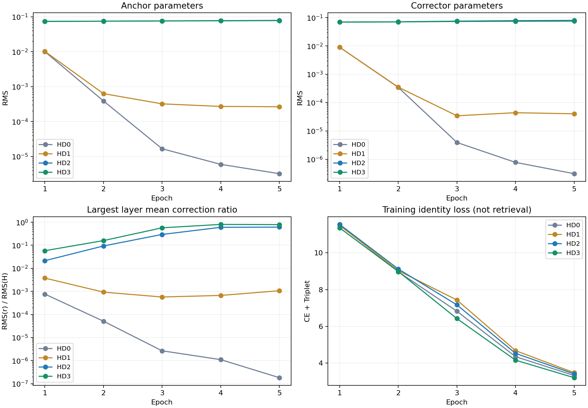
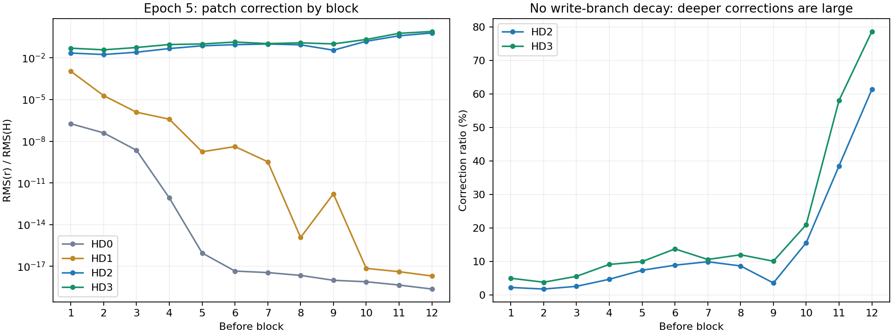

# HD0—HD3优化诊断结果分析与下一步建议（2026-10-09）

## Material Passport

- 任务：分析α×写入通道weight decay四组短程对照，定位原HI修正分支退化问题并确定后续实验优先级。
- Verification Status：**ANALYZED**。基于已完成的服务器训练日志、配置与梯度诊断；没有重新训练，没有本轮本地权重前向核验。
- 数据目录：`E:/CVPR2027/ref/Trajectory_runs/history_optimization_1009/HD{0,1,2,3}_e5_seed1234`。
- 比较参照：原`history_innovation_1009/HI3_seed1234/history_epoch.jsonl`前5条。
- 实现提交：四组均记录`65419b11f010c8a22cd36ddeccf4f100baa2d8a0`；源码对照为本阶段optimizer、processor与history_optimization实现。
- 固定口径：60epoch日程下训练前5epoch、seed1234、原llmpar/CLIP norm/单卡A800。**本批没有mAP/Rank-1结果，不属于四组60epoch性能实验。**
- 文件边界：四组日志和诊断完整，但本地目录未发现`transformer_5.pth`。stop记录写明该权重名，不能据此声称已在本地核验权重。缺少权重不妨碍本报告的日志分析，不需要因此补训。

## 1. 结论：现在能够比上一轮更明确地定位问题

**在当前HI结构和优化流程下，写入通道沿用1e-4的Adam耦合weight decay，是前5epoch快速收缩的一个主要可干预因素；仅把α从0.25增大到1不足以解决问题。**

这不是仅从参数很小反推原因，而是获得了三条相互支持的证据：

1. HD0的前5epoch原有诊断字段与原HI3**全部精确一致**，因此新增只读诊断在这次正式服务器运行中没有造成可观测的原字段变化，原退化现象被复现。
2. 保留衰减的HD0/HD1中，Anchor和Corrector都快速收缩；在两种α下分别取消写入通道衰减的HD2/HD3，都维持了方向网络，并产生持续可测的修正。这构成对当前设置的两组匹配干预证据。
3. HD0第1epoch未跳步抽样中，Anchor/Corrector衰减项范数相对clip后数据梯度的中位数分别为15.64/58.92；HD1仍为2.68/11.92。早期梯度和参数收缩相互吻合。

**边界：** 这支持定位“初期退化”的主要因素，不等于已经证明weight decay是唯一原因、0是最优衰减值，或不衰减后60epoch检索一定更好。全局clip、乘法增益与Adam共同构成当前背景条件；本次没有分别消融它们，也没有分开gain与方向网络的WD。

**下一步建议：停止围绕HD0/HD1扩展；将HD2与HD3推进到正式性能验证。当前无需为了定位早期收缩再统一补10epoch，也不能只根据HD3训练loss更低就宣布α=1最好。**

## 2. 数据有效性与实验一致性

| 检查项 | 结果 |
| --- | --- |
| 训练epoch | 每组连续1—5，正常停止 |
| 学习率总日程 | MAX_EPOCHS=60，STOP_AFTER_EPOCH=5 |
| 实际步数 | 每组各epoch为458、458、455、459、457，总计2287 |
| AMP跳步 | 每组8次，全部在epoch1；实际optimizer更新2279次 |
| epoch诊断 | 每组5条，与train_log内联JSON逐条完全一致 |
| 梯度诊断 | 每组50条，覆盖首步＋每50步；其中1条抽样处于跳步，49条可用于正常梯度分析 |
| 代码版本 | 四组相同，65419b1 |
| source_status | 四组仅`D README.md`，记录中无训练源码改动 |
| runtime | Python3.8.20、torch2.4.1+cu121、torchvision0.13.1、timm1.0.19、cuDNN90100、A800-SXM4-80GB |
| cuDNN | benchmark=True、deterministic=True |
| 配置差异 | 除输出目录外，仅α、写入通道WD按2×2矩阵变化 |
| 学习率一致性 | 四组epoch末记录的参数组LR完全相同；与原HI3前5epoch日程一致 |
| 异常 | 未发现Traceback/OOM/非有限训练loss；少量AMP跳步已明确记录，不称“无溢出” |
| 权重文件 | 本地四组均未发现，未执行checkpoint反查与离线推理 |

50条梯度记录只覆盖抽样batch，不能把其中1条跳步误认为全训练只跳过1次，也不能把49条样本当成49次独立训练。本文梯度统计均排除`amp_skipped=True`记录；第1epoch有效9条，第2—5epoch各10条。

四组训练迭代计时各约10.2—10.3分钟（根据日志每步秒数×实际步数估算），不包含完整任务的所有启动开销。没有本批正式峰值显存数据。

### 2.1 四组实际定义

| 组别 | α | 写入通道WD | Predictor WD | 范围 | 预测λ |
| --- | --- | --- | --- | --- | --- |
| HD0 | 0.25 | 1e-4 | 1e-4 | patch | 1 |
| HD1 | 1.0 | 1e-4 | 1e-4 | patch | 1 |
| HD2 | 0.25 | 0 | 1e-4 | patch | 1 |
| HD3 | 1.0 | 0 | 1e-4 | patch | 1 |

写入通道指gain、Anchor、Corrector及其bias，Predictor未取消衰减。原baseline/C0优化设置没有被修改；不是把全模型weight decay改成0。

### 2.2 HD0与原HI3的复现结果

将原HI3前5条epoch JSON中的全部字段，逐层、逐数值与HD0对应原有字段比较，差异数为0。比较包含CE、Triplet、预测loss、gain分布、逐层预测/修正统计、迭代数和AMP跳步；HD0新增的optimization字段不参与旧字段比较。

这是很有价值的训练轨迹一致性证据，但不等价于权重逐元素一致：原HI3没有提供对应早期权重，本轮本地也未提供第5epoch权重。

## 3. 第5epoch核心结果

| 组别 | αG RMS | Anchor RMS | Corrector RMS | 12层修正比例均值 | 最大层均修正比例 | CE | Triplet |
| --- | --- | --- | --- | --- | --- | --- | --- |
| HD0 | 2.097e-06 | 3.221e-06 | 3.089e-07 | 1.864e-08 | 1.817e-07 | 2.3244 | 1.0037 |
| HD1 | 2.866e-04 | 2.659e-04 | 4.017e-05 | 9.094e-05 | 1.071e-03 | 2.4706 | 1.0087 |
| HD2 | 6.672e-03 | 7.872e-02 | 7.966e-02 | 1.374e-01 | 6.136e-01 | 2.4164 | 0.9982 |
| HD3 | 2.255e-02 | 7.775e-02 | 7.538e-02 | 1.978e-01 | 7.870e-01 | 2.2314 | 0.9785 |

修正比例定义为`RMS(r)/RMS(H)`；先对每epoch抽样batch得到各层均值，表中再计算层均值/最大层均值。它不是最大单样本变化，不是向量夹角，不是特征差异百分比，也不能将12层比例直接相加解释最终输出变化。

### 3.1 方向网络剩余量：不是只有gain统计变了

| 组别 | Anchor：epoch5/初始化 | Corrector：epoch5/初始化 |
| --- | --- | --- |
| HD0 | 0.00446% | 0.00046% |
| HD1 | 0.36791% | 0.05976% |
| HD2 | 108.93858% | 118.49477% |
| HD3 | 107.58971% | 112.12869% |

HD0的Anchor只剩初始化RMS的约0.00446%，Corrector约0.00046%；HD1虽有缓解，但也仅剩约0.368%/0.060%。HD2/HD3则保持在初始化附近并有所增长。**仅α=1并没有阻止方向网络退化，取消写入衰减在两种α下都阻止了这一早期现象。**



### 3.2 α增大的作用与局限

保留衰减时，HD1相对HD0有更大的有效gain与局部修正，说明α不是完全无影响；但第5epoch的修正主要保留在第1个block前，后续深层仍接近关闭。

第1层没有历史预测，其创新量直接取当前状态S。因此，不能把HD1第1层残存的修正当成多层历史预测机制已经恢复的证据。

取消衰减时，HD3的有效gain约为HD2的3.38倍，最大层均修正比例却只约为1.28倍；两组G、方向与主干状态都随训练改变，不能期待残差一定精确放大4倍。HD3原始G RMS反而比HD2小（约0.02255对0.02669），这并不代表HD3退化，更说明不同α下应比较αG及实际r。

## 4. 衰减为什么是优先原因：梯度证据

### 4.1 第1epoch：方向网络数据梯度不足以抵抗当前衰减设置

下表为未跳步抽样batch中“衰减项范数/clip后数据梯度范数”的中位数。不是最终Adam参数更新的比例；没有使用范数相减假装向量方向一致。

| 组别 | gain | Anchor | Corrector | Predictor | 全模型clip前梯度范数中位数 |
| --- | --- | --- | --- | --- | --- |
| HD0 | 0.062 | 15.645 | 58.920 | 21.698 | 316.33 |
| HD1 | 0.032 | 2.680 | 11.922 | 8.809 | 278.75 |
| HD2 | 0.000 | 0.000 | 0.000 | 16.792 | 428.67 |
| HD3 | 0.000 | 0.000 | 0.000 | 3.135 | 261.63 |

HD0与HD1第1epoch的9个有效抽样中，Anchor和Corrector的该比例全部大于1。全局clip阈值为1，而全模型梯度范数中位数约为数百；数据梯度经过共同缩小之后，Adam再加入耦合衰减项。这使当前参数化下的方向网络更容易受衰减影响。

gain零初始化时方向网络的直接身份梯度为零，后续仍被小gain缩放；衰减项却作用于非零初始化的方向参数。该机制与“方向迅速收缩、增益与身份路径进一步变弱”的过程一致。

这并不意味着全局clip是错误的，也不意味着应修改原baseline的clip。当前最小有效干预是针对新写入通道调整衰减；没有证据要求改变全部模型优化方式。

### 4.2 为什么不能只看第5epoch末梯度

| epoch | HD0 Anchor衰减/数据 | HD0 Corrector衰减/数据 | HD1 Anchor衰减/数据 | HD1 Corrector衰减/数据 |
| --- | --- | --- | --- | --- |
| 1 | 15.645 | 58.920 | 2.680 | 11.922 |
| 2 | 3.675 | 31.442 | 0.402 | 3.012 |
| 3 | 0.260 | 2.303 | 0.079 | 0.094 |
| 4 | 0.115 | 0.146 | 0.078 | 0.092 |
| 5 | 0.096 | 0.090 | 0.050 | 0.065 |

到第5epoch，参数已很小，其衰减项也随之缩小，所以比例降到1以下，不能据此否定早期衰减问题。只检查最终一条batch会漏掉收缩发生的关键阶段。

反过来，取消衰减后不收缩也不是因为参数完全没学：HD2/HD3的方向参数RMS变化、有效gain增长、逐层实际修正非零，而且Predictor开始收到可观的身份梯度。

## 5. 预测器与身份任务的联系发生了变化

下表统计Predictor中“加权预测辅助梯度范数/身份梯度范数”的逐batch比值中位数，均来自未跳步抽样。当前λ=1，数值不代表梯度方向一致或冲突。

| epoch | HD0 | HD1 | HD2 | HD3 |
| --- | --- | --- | --- | --- |
| 1 | 5.266e+00 | 1.870e+00 | 7.348e-01 | 3.035e-01 |
| 2 | 6.218e+02 | 3.218e+01 | 7.847e-01 | 2.562e-01 |
| 3 | 2.711e+04 | 7.226e+01 | 5.863e-01 | 3.329e-01 |
| 4 | 1.784e+05 | 4.551e+02 | 5.116e-01 | 2.518e-01 |
| 5 | 4.063e+05 | 9.714e+02 | 4.225e-01 | 2.420e-01 |

HD0从epoch1的约5.27升至epoch5的约40.6万，说明写入路径退化后，Predictor越来越像一个几乎脱离身份训练的辅助预测器。HD1末期仍约971倍，未恢复到同量级联系。

HD2/HD3第5epoch则分别约0.422/0.242，即Predictor收到的身份梯度范数已大于辅助梯度。这支持“保住写入路径之后，预测器能通过修正参与身份目标优化”，但不能据此证明预测辅助loss本身有正贡献，也不能据此决定λ应该放大。

所有四组有效记录中，预测loss对gain、Anchor、Corrector的直接梯度均为0，与detach边界一致。若要保住这三部分，单纯放大预测loss不是直接的解决办法。

第5epoch的loss与预测收益：

| 组别 | CE＋Triplet | 原始预测loss | 预测/(CE＋Triplet) | 第2—12层均预测收益 |
| --- | --- | --- | --- | --- |
| HD0 | 3.3281 | 0.1553 | 4.67% | 32.70% |
| HD1 | 3.4794 | 0.1500 | 4.31% | 34.81% |
| HD2 | 3.4147 | 0.1632 | 4.78% | 35.82% |
| HD3 | 3.2099 | 0.1766 | 5.50% | 30.00% |

HD3的身份loss最低，但预测loss最高、相对copy的层均收益低于其他组。不能据此判定它的预测器更差：不同修正已经改变主干状态和预测target，原始预测loss不再是在同一目标上比较。更不能只按预测误差选最优检索模型。

当前HD3身份loss较低只是训练拟合证据，不是泛化或mAP证据。HD2的身份loss略高于HD0，也不能据此淘汰HD2。

## 6. 新的关注点：修正已较强，尤其在后层



下表为第5epoch各block前的patch修正比例，单位%。极小值保留科学计数法，避免打印0掩盖差异。

| block前 | HD0 | HD1 | HD2 | HD3 |
| --- | --- | --- | --- | --- |
| 1 | 1.817e-05 | 0.1071 | 2.2083 | 4.9606 |
| 2 | 3.971e-06 | 0.0019 | 1.7343 | 3.7747 |
| 3 | 2.235e-07 | 1.224e-04 | 2.5411 | 5.5320 |
| 4 | 8.309e-11 | 3.855e-05 | 4.6570 | 9.0866 |
| 5 | 9.101e-15 | 1.737e-07 | 7.3431 | 9.9465 |
| 6 | 4.548e-16 | 4.138e-07 | 8.8638 | 13.7258 |
| 7 | 3.538e-16 | 3.318e-08 | 9.8939 | 10.5716 |
| 8 | 2.215e-16 | 1.186e-13 | 8.6385 | 11.9737 |
| 9 | 9.862e-17 | 1.626e-10 | 3.5495 | 10.0539 |
| 10 | 7.744e-17 | 7.110e-16 | 15.5818 | 20.9780 |
| 11 | 4.499e-17 | 4.100e-16 | 38.5303 | 58.0978 |
| 12 | 2.316e-17 | 2.013e-16 | 61.3619 | 78.7026 |

HD2、HD3第12层分别约61.36%和78.70%，第11层分别约38.53%和58.10%。HD3的12层均值约19.78%，HD2约13.74%。这说明取消衰减并非只保住了数值上非零、实际仍可忽略的分支。

但这些比例已不适合称为“极小扰动”。本批没有NaN、后四epoch没有AMP跳步，HD3第12层比例从epoch4约80.28%到epoch5约78.70%，尚无单调失控的证据；同时，也不能由前5epoch正常就保证60epoch不出现放大、过拟合或不利写入。

因此后续应观察实际检索和后期残差，而不是继续优先放大α、放大预测loss，或人为追求更大的修正。也不建议仅凭比例大就立即加硬裁剪/新正则：那会引入新变量，当前尚无性能证据证明必须这样做。

## 7. 对此前判断的更新

| 问题 | 本轮后的判断 |
| --- | --- |
| 是否主要是方法没接入forward？ | 不支持；原轨迹精确复现，干预后多层写入与梯度明显变化 |
| 仅将α改成1能否解决退化？ | 前5epoch证据表明不能，HD1深层仍关闭 |
| 取消写入通道WD是否有效？ | 对阻止初期收缩有很强证据；两种α下均成立 |
| α=1是否比0.25检索更好？ | 仍未确定，本批没有检索指标 |
| 新方案能否改进？ | 已找到能改变失败机制的具体修改；是否提高整体性能仍需正式实验 |
| 预测监督是不是该删除？ | 不能沿用旧HI1/HI0结论直接决定；优化修复后身份梯度路径已改变，需要新的λ对照 |
| 是否已证明权重衰减为唯一原因？ | 没有；参数化、全局clip与Adam仍是背景因素，且没有分别消融gain/方向衰减 |

此前“未发现接线或组别映射错误”和现在“优化设置存在适配问题”不矛盾。这里更像把旧训练配置直接沿用到新的乘法分支后产生的优化问题，不能简单归类为新思想已被否定，也不需要据此修改baseline定义。

## 8. 下一步建议：进入正式性能验证，保留两种α

### 8.1 不再统一补跑10epoch

原计划只在5epoch证据不清楚时延长到10epoch。现在取消写入衰减的效果在两种α下都清楚，继续短程测试不能回答最终检索是否改善，因此建议直接把HD2/HD3送入60epoch性能验证。

如果后续出现非有限loss、残差持续失控或严重训练异常，再停止对应任务分析；当前不需要人为设定一个未经验证的残差阈值筛掉方案。

### 8.2 若仍使用四张独立单卡，推荐四组正式实验

| 正式任务 | 已有配置来源 | α | 写入WD | 范围 | λ | 要回答的问题 |
| --- | --- | --- | --- | --- | --- | --- |
| HD2_HF1 | HD2 + HF1 | 0.25 | 0 | patch | 1 | 较小固定尺度、修复退化后的性能 |
| HD3_HF1 | HD3 + HF1 | 1.0 | 0 | patch | 1 | 与上一组匹配比较α是否影响最终性能 |
| HD3_HF2 | HD3 + HF2 | 1.0 | 0 | patch | 0 | 同尺度下预测监督是否带来额外收益 |
| HD3_HF3 | HD3 + HF3 | 1.0 | 0 | CLS＋patch | 1 | 同尺度下增加CLS是否有益 |

这是把原三组HF计划增加一个HD2_HF1尺度参照。**HD3在这里是优先探索的中心配置，不是已认定最优的O。** 理由是它已保住写入且早期身份拟合较好；为避免把训练loss当最终选择依据，必须同时保留HD2_HF1。

HF2保留预测器，只不加入预测辅助loss；HF3仅扩展CLS写入，预测loss仍只监督patch。四组都从相同CLIP初始化完整训练，不能从第5epoch接训冒充统一起点。固定第60epochpost-BN主结果、同权重pre-BN补充。

这四组不构成α×范围×预测λ的完整因子设计：如果最后HD2胜出，不能直接宣称HD3上的CLS或预测损失结论也适用于HD2。届时再针对胜出设置补必要对照，不现在铺满所有组合。

如只安排两组，优先HD2_HF1与HD3_HF1，先回答尺度与最终检索问题，再将获胜候选作为O开展预测/CLS对照。

### 8.3 实施状态与现有命令

现有代码已经支持上述四组，不需要为本建议修改训练实现。本次只完成结果分析，**没有在服务器生成正式配置、没有启动新训练，也没有替用户自动宣布哪个O最好。**

若采用四组建议，先在服务器显式生成两套配置（若对应目录已存在，检查内容后直接使用，不删除覆盖）：

```bash
/mnt/cache/wanghanzhi/envs/llmpar/bin/python3 /mnt/cache/wanghanzhi/XK/Trajectory_history/tools/prepare_history_followup.py --choice HD2
/mnt/cache/wanghanzhi/envs/llmpar/bin/python3 /mnt/cache/wanghanzhi/XK/Trajectory_history/tools/prepare_history_followup.py --choice HD3
```

四个单卡任务分别运行：

```bash
bash /mnt/cache/wanghanzhi/XK/Trajectory_history/server/history_optimization/sensecore/run_HF1.sh HD2
```

```bash
bash /mnt/cache/wanghanzhi/XK/Trajectory_history/server/history_optimization/sensecore/run_HF1.sh HD3
```

```bash
bash /mnt/cache/wanghanzhi/XK/Trajectory_history/server/history_optimization/sensecore/run_HF2.sh HD3
```

```bash
bash /mnt/cache/wanghanzhi/XK/Trajectory_history/server/history_optimization/sensecore/run_HF3.sh HD3
```

不需要运行HD2_HF2/HD2_HF3；生成配置不等于要求运行全部组合。完整路径、环境和输出规则沿用[doc32手册](32.HD优化诊断与HF后续单卡实验手册_1009.md)。

### 8.4 本地缺少权重如何处理

本地四组都缺transformer_5.pth，因此本报告未做新checkpoint参数反查或前向开关；也没有运行预测器历史置换检查。如果服务器还保留权重，建议后续一并归档下载，不必为此重训。正式HF从初始化开始，不依赖这些第5epoch权重，缺少它们不构成HF启动的技术阻碍。

## 9. 原始证据与解释范围

每组主要证据：

- `resolved_config.yml`：完整展开后的配置。
- `history_optimizer_initial.json`：实际参数分组WD/LR及初始范数。
- `history_epoch.jsonl`：第1—5行分别对应第1—5epoch，含实际修正和epoch末参数统计。
- `history_gradients.jsonl`：第1—10行是epoch1，第41—50行是epoch5；正常样本按amp_skipped过滤，不能直接把最后一条当epoch平均。
- `train_log_*.txt`：runtime、训练完成日志与内联epoch JSON。
- `history_stop.json`：第5epoch正常停止、60epoch日程及权重名。

本报告图表由解析脚本提取数据后生成，没有修改原始输出。脚本`tools/analyze_history_optimization_results.py`复核完整性并输出parsed_hd.json；大体积原始/解析日志均留在忽略的work目录，不加入Git。

复核命令（Windows解释器需具备PyYAML）：

```powershell
python -X utf8 tools/analyze_history_optimization_results.py --runs-root E:/CVPR2027/ref/Trajectory_runs --output work/hd_analysis_review
```

单seed的匹配干预可以为当前训练设置的退化原因提供证据，但不能自动给出跨seed稳定性、跨数据集普适性或检索显著性。本报告不提出多seed补训要求，也不编造p值。

统计解释清单11/11已核对：聚合反转以逐层表补充；不将层均量解释成每张图；结论限制在当前采样与协议；没有按结果额外筛样的因果控制；报告完整步数与抽样分母；不从较差组反弹推断泛化；四组及跳步均保留；不只挑有利梯度；遵守原5epoch诊断而非检索选优；干预证据与未验证机制分开；不由低训练loss反推身份机制正确。筛掉AMP跳步仅用于有效梯度统计，完整训练跳步数仍单独报告。

## 附录：五个epoch的完整关键轨迹
### HD0

| epoch | G RMS | αG RMS | Anchor RMS | Corrector RMS | 修正层均值 | 最大层均修正 | CE | Triplet | 预测loss |
| --- | --- | --- | --- | --- | --- | --- | --- | --- | --- |
| 1 | 6.520e-04 | 1.630e-04 | 1.005e-02 | 8.982e-03 | 3.128e-04 | 7.655e-04 | 6.1207 | 5.4288 | 0.3153 |
| 2 | 1.154e-04 | 2.885e-05 | 3.891e-04 | 3.449e-04 | 1.481e-05 | 5.106e-05 | 5.7607 | 3.2128 | 0.2740 |
| 3 | 4.178e-05 | 1.044e-05 | 1.666e-05 | 3.901e-06 | 4.010e-07 | 2.661e-06 | 4.6949 | 2.1315 | 0.2170 |
| 4 | 1.882e-05 | 4.705e-06 | 5.955e-06 | 7.730e-07 | 1.035e-07 | 1.101e-06 | 3.2430 | 1.1109 | 0.1545 |
| 5 | 8.389e-06 | 2.097e-06 | 3.221e-06 | 3.089e-07 | 1.864e-08 | 1.817e-07 | 2.3244 | 1.0037 | 0.1553 |

### HD1

| epoch | G RMS | αG RMS | Anchor RMS | Corrector RMS | 修正层均值 | 最大层均修正 | CE | Triplet | 预测loss |
| --- | --- | --- | --- | --- | --- | --- | --- | --- | --- |
| 1 | 1.467e-03 | 1.467e-03 | 1.023e-02 | 8.988e-03 | 1.948e-03 | 3.773e-03 | 6.1125 | 5.3802 | 0.3194 |
| 2 | 5.571e-04 | 5.571e-04 | 6.305e-04 | 3.501e-04 | 2.252e-04 | 9.302e-04 | 5.7881 | 3.2470 | 0.2851 |
| 3 | 3.980e-04 | 3.980e-04 | 3.213e-04 | 3.417e-05 | 7.489e-05 | 5.719e-04 | 5.0034 | 2.4323 | 0.2393 |
| 4 | 3.220e-04 | 3.220e-04 | 2.713e-04 | 4.393e-05 | 6.289e-05 | 6.690e-04 | 3.5243 | 1.1585 | 0.1540 |
| 5 | 2.866e-04 | 2.866e-04 | 2.659e-04 | 4.017e-05 | 9.094e-05 | 1.071e-03 | 2.4706 | 1.0087 | 0.1500 |

### HD2

| epoch | G RMS | αG RMS | Anchor RMS | Corrector RMS | 修正层均值 | 最大层均修正 | CE | Triplet | 预测loss |
| --- | --- | --- | --- | --- | --- | --- | --- | --- | --- |
| 1 | 1.069e-02 | 2.672e-03 | 7.364e-02 | 6.938e-02 | 5.691e-03 | 2.144e-02 | 6.1302 | 5.4180 | 0.3172 |
| 2 | 1.508e-02 | 3.770e-03 | 7.476e-02 | 7.119e-02 | 2.007e-02 | 9.330e-02 | 5.8867 | 3.2378 | 0.2829 |
| 3 | 2.076e-02 | 5.191e-03 | 7.616e-02 | 7.500e-02 | 4.942e-02 | 2.948e-01 | 4.9822 | 2.1890 | 0.2316 |
| 4 | 2.453e-02 | 6.133e-03 | 7.742e-02 | 7.811e-02 | 1.141e-01 | 6.009e-01 | 3.4455 | 1.0875 | 0.1595 |
| 5 | 2.669e-02 | 6.672e-03 | 7.872e-02 | 7.966e-02 | 1.374e-01 | 6.136e-01 | 2.4164 | 0.9982 | 0.1632 |

### HD3

| epoch | G RMS | αG RMS | Anchor RMS | Corrector RMS | 修正层均值 | 最大层均修正 | CE | Triplet | 预测loss |
| --- | --- | --- | --- | --- | --- | --- | --- | --- | --- |
| 1 | 9.347e-03 | 9.347e-03 | 7.384e-02 | 6.934e-02 | 2.111e-02 | 5.814e-02 | 6.1203 | 5.2395 | 0.3147 |
| 2 | 1.329e-02 | 1.329e-02 | 7.483e-02 | 7.066e-02 | 4.935e-02 | 1.596e-01 | 5.8503 | 3.1367 | 0.2741 |
| 3 | 1.828e-02 | 1.828e-02 | 7.590e-02 | 7.313e-02 | 1.144e-01 | 5.723e-01 | 4.6733 | 1.7519 | 0.2116 |
| 4 | 2.077e-02 | 2.077e-02 | 7.679e-02 | 7.443e-02 | 1.810e-01 | 8.028e-01 | 3.1254 | 1.0372 | 0.1687 |
| 5 | 2.255e-02 | 2.255e-02 | 7.775e-02 | 7.538e-02 | 1.978e-01 | 7.870e-01 | 2.2314 | 0.9785 | 0.1766 |
