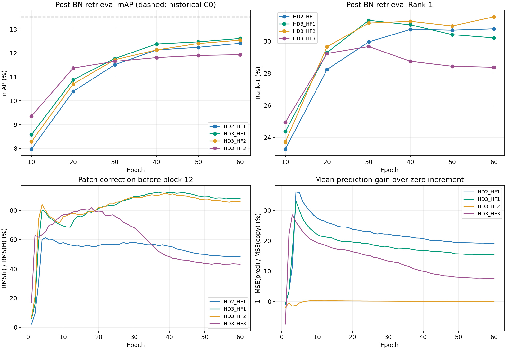
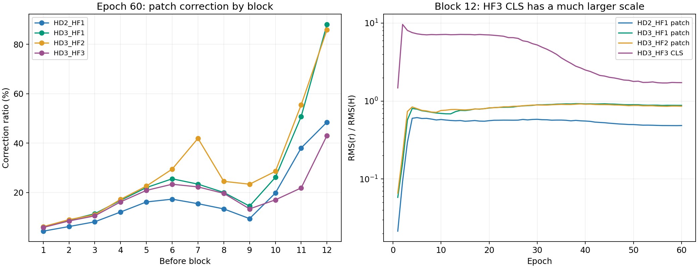
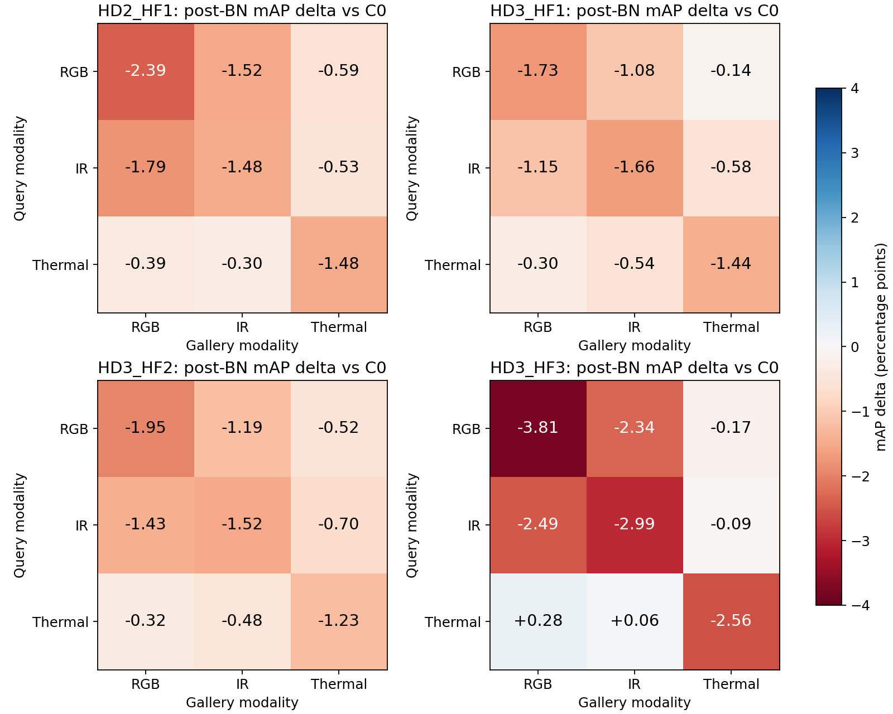

# HF四组60epoch实验结果分析与下一步建议（2026-10-10）

## Material Passport

- 任务：分析写入通道取消weight decay后的四组正式训练，验证尺度α、预测辅助损失和CLS写入的效果。
- Verification Status：**ANALYZED**。交叉核对服务器配置、训练/测试日志、60条epoch诊断和梯度抽样；本次没有重新训练或重跑完整检索。
- 原始目录：`E:/CVPR2027/ref/Trajectory_runs/history_followup_1009/`。
- 实现提交：四组均为`65419b11f010c8a22cd36ddeccf4f100baa2d8a0`，与HD短程诊断一致。source_status均为`D README.md`及`?? configs/history_followup/`；后者是本阶段生成的未跟踪配置目录，实际运行配置已另存并核对，没有记录到已跟踪训练源码修改。
- 结果口径：固定第60epoch，post-BN为主、同checkpoint的pre-BN为补充；数值单位%，差值为百分点（pp）。保留全部四组，不事后用早期checkpoint替换结果。
- 历史参照：baseline使用用户提供数值；C0/T1/T2及HI0—HI3从本地历史独立测试日志重新提取。它们不是本轮重训对照，历史比较不能替代同批单因素比较。
- 权重边界：本地四个目录均未发现`transformer_60.pth`。服务器console记录了对应权重加载及评估，本文没有本地checkpoint反查、修正开关或历史置换前向验证。

## 1. 结论与研究判断

**本轮解决了写入分支收缩，却没有获得预期的检索提升。当前完整历史创新量适配不能替代C0，继续扩大修正或增加CLS写入缺乏支持。**

1. 主结果最高mAP是HD3_HF1的**12.61%**，最高Rank-1是HD3_HF2的**31.51%**；没有一组在全部指标上最优，四组均未超过历史C0。
2. HD2_HF1、HD3_HF1和HD3_HF2相对历史baseline只有部分指标改善；HD3_HF3的post/pre四项指标全部低于历史baseline。不能把前三组称为完整的baseline提升。
3. 方向网络和实际修正一直保留到epoch60，修正分支没有再次整体归零。因此，“前几轮主要因为没有修正，所以只要保住修正就能更好”的后半段推断没有得到实验支持。
4. α=1相对α=0.25提升mAP、Rank-5/10，但降低Rank-1；不是α=1全面更好。预测损失λ=1相对λ=0仅有很小mAP优势，并伴随Rank-1下降；尚无一致的检索收益。
5. 在本轮优化条件下，加入CLS写入明显降低整体表现，且第12层CLS修正早期超过输入RMS数倍。上一轮HI2>HI1的CLS收益没有在当前活跃写入条件下复现。

**建议：继续保留C0为模块一和主要方法参照；暂停当前完整结构的放大/组合实验。若继续历史方向，先用已有权重检验修正与预测的实际贡献，再用最小结构对照决定删减或约束哪一部分。** 本报告不建议多seed、T0或baseline重训。

## 2. 实验定义与数据核验

### 2.1 四组实际执行的设置

| 组别 | α | 写入WD | token范围 | 预测λ |
| --- | --- | --- | --- | --- |
| HD2_HF1 | 0.25 | 0 | patch | 1.0 |
| HD3_HF1 | 1.0 | 0 | patch | 1.0 |
| HD3_HF2 | 1.0 | 0 | patch | 0.0 |
| HD3_HF3 | 1.0 | 0 | CLS＋patch | 1.0 |

所有组均使用线性增益`r_l=αG_l⊙D_l`、rank64、12个block前修正；第2—12层预测。取消衰减的对象为patch/CLS gain、Anchor和Corrector，包括其bias；Predictor仍为WD=1e-4。C0、TEXT_ALIGN、MOD_DELTA、VPR、JPM、SIE等旧方法开关全部关闭。

HF2仅取消预测辅助损失，保留预测网络与同一forward；原始预测loss继续记录，但不加入优化。HF3增加独立CLS增益和CLS历史，网络与patch共享，预测辅助损失仍只针对patch。这四组不是α×λ×范围的完整因子设计，HF2/HF3结论限定于α=1。

### 2.2 完整性核验

- 四组均完成epoch1—60，60条JSONL与train_log内联JSON逐条一致；每组共有27490次训练尝试，逐epoch步数完全相同。日志469为sampler估计分母，不能据此认为少训练。
- 每10epoch评估一次，共6次；最后训练评估的post指标与独立post测试完全一致。两份独立测试的实际展开配置均指向本组`transformer_60.pth`，实际NECK_FEAT为after/before。
- 测试日志先打印原YAML，再打印命令行覆盖后的实际配置；本文读取最后的实际配置，避免把YAML默认after误判为pre测试未切换。
- 相对HD3_HF1，HD2_HF1仅α、HD3_HF2仅预测λ、HD3_HF3仅token范围不同，另有独立OUTPUT_DIR。selected_config经过yacs字面值解析及脚本路径覆盖后，与resolved_config一致。
- HD2_HF1、HD3_HF1的前5条epoch诊断分别与已完成HD2、HD3逐字段完全相同，支持正式训练从相同初始化和日程开始。
- Runtime统一为Python3.8.20、torch2.4.1+cu121、torchvision0.13.1、timm1.0.19、cuDNN90100、A800-SXM4-80GB；benchmark=True、deterministic=True。CLIP norm、seed1234、PKM/K4、逻辑batch64（三模态实际192图）保持一致。
- 数据统计一致：训练500ID/92133图，query500ID/6405图，gallery500ID/93609图；每模态query2135。query空1350/地5055，gallery空23343/地70266。
- 服务器两次独立加载中，前三组均记录267/268张量，HF3记录268/269张量；仅跳过分类器。源码对history签名、形状和缺失张量有明确检查，console未记录其它加载异常。源码在测试加载时直接跳过分类器；日志括注identity counts differ不是本轮实际身份数变化的证明。分类器不参与检索特征计算；本次也没有执行本地严格加载核验。
- 未发现Traceback、OOM或非有限训练loss/epoch诊断；存在少量AMP跳步，完整计数如下。没有本批峰值显存证据。

| 组别 | 训练尝试 | AMP跳步 | 实际更新 | 梯度抽样/有效 | 训练迭代估计/min |
| --- | --- | --- | --- | --- | --- |
| HD2_HF1 | 27490 | 15 | 27475 | 600/598 | 121.5 |
| HD3_HF1 | 27490 | 15 | 27475 | 600/599 | 121.8 |
| HD3_HF2 | 27490 | 15 | 27475 | 600/599 | 123.1 |
| HD3_HF3 | 27490 | 17 | 27473 | 600/599 | 125.7 |

每组首epoch跳步8次，其余跳步分散在后期；有效梯度统计排除跳步记录，完整训练计数仍保留。抽样batch不是独立训练重复。耗时按日志每步计时×实际步数估算，不含全部启动、评估和独立测试。

## 3. 第60epoch总体检索结果

### 3.1 post-BN主结果

| 方案 | mAP | Rank-1 | Rank-5 | Rank-10 |
| --- | --- | --- | --- | --- |
| baseline | 12.38 | 31.02 | 47.76 | 55.80 |
| C0 | 13.52 | 33.61 | 50.05 | 58.19 |
| T1 | 13.42 | 33.94 | 50.18 | 58.38 |
| T2 | 13.45 | 33.13 | 50.55 | 58.41 |
| HI3 | 13.57 | 33.49 | 49.95 | 57.72 |
| HD2_HF1 | 12.41 | 30.76 | 47.35 | 54.88 |
| HD3_HF1 | 12.61 | 30.20 | 47.71 | 55.75 |
| HD3_HF2 | 12.54 | 31.51 | 47.92 | 55.64 |
| HD3_HF3 | 11.93 | 28.37 | 45.17 | 53.07 |

### 3.2 pre-BN补充结果

| 方案 | mAP | Rank-1 | Rank-5 | Rank-10 |
| --- | --- | --- | --- | --- |
| baseline | 11.99 | 31.10 | 48.57 | 56.69 |
| C0 | 13.13 | 33.74 | 50.57 | 58.30 |
| T1 | 12.92 | 33.11 | 51.16 | 59.00 |
| T2 | 12.99 | 33.11 | 50.34 | 58.49 |
| HI3 | 13.21 | 34.11 | 50.71 | 58.66 |
| HD2_HF1 | 12.05 | 31.13 | 48.02 | 55.53 |
| HD3_HF1 | 12.32 | 30.57 | 48.29 | 56.38 |
| HD3_HF2 | 12.15 | 31.19 | 48.38 | 56.47 |
| HD3_HF3 | 11.93 | 28.37 | 45.00 | 53.29 |

baseline/C0/T1/T2/HI3均为历史参照。本轮post的mAP排序为HD3_HF1 > HD3_HF2 > HD2_HF1 > HD3_HF3；Rank-1则为HD3_HF2 > HD2_HF1 > HD3_HF1 > HD3_HF3。

### 相对历史baseline/C0/HI3的差值：post-BN，单位pp

| 本轮方案 | 参照 | ΔmAP | ΔRank-1 | ΔRank-5 | ΔRank-10 |
| --- | --- | --- | --- | --- | --- |
| HD2_HF1 | baseline | +0.03 | -0.26 | -0.41 | -0.92 |
| HD2_HF1 | C0 | -1.11 | -2.85 | -2.70 | -3.31 |
| HD2_HF1 | HI3 | -1.16 | -2.73 | -2.60 | -2.84 |
| HD3_HF1 | baseline | +0.23 | -0.82 | -0.05 | -0.05 |
| HD3_HF1 | C0 | -0.91 | -3.41 | -2.34 | -2.44 |
| HD3_HF1 | HI3 | -0.96 | -3.29 | -2.24 | -1.97 |
| HD3_HF2 | baseline | +0.16 | +0.49 | +0.16 | -0.16 |
| HD3_HF2 | C0 | -0.98 | -2.10 | -2.13 | -2.55 |
| HD3_HF2 | HI3 | -1.03 | -1.98 | -2.03 | -2.08 |
| HD3_HF3 | baseline | -0.45 | -2.65 | -2.59 | -2.73 |
| HD3_HF3 | C0 | -1.59 | -5.24 | -4.88 | -5.12 |
| HD3_HF3 | HI3 | -1.64 | -5.12 | -4.78 | -4.65 |

### 相对历史baseline/C0/HI3的差值：pre-BN，单位pp

| 本轮方案 | 参照 | ΔmAP | ΔRank-1 | ΔRank-5 | ΔRank-10 |
| --- | --- | --- | --- | --- | --- |
| HD2_HF1 | baseline | +0.06 | +0.03 | -0.55 | -1.16 |
| HD2_HF1 | C0 | -1.08 | -2.61 | -2.55 | -2.77 |
| HD2_HF1 | HI3 | -1.16 | -2.98 | -2.69 | -3.13 |
| HD3_HF1 | baseline | +0.33 | -0.53 | -0.28 | -0.31 |
| HD3_HF1 | C0 | -0.81 | -3.17 | -2.28 | -1.92 |
| HD3_HF1 | HI3 | -0.89 | -3.54 | -2.42 | -2.28 |
| HD3_HF2 | baseline | +0.16 | +0.09 | -0.19 | -0.22 |
| HD3_HF2 | C0 | -0.98 | -2.55 | -2.19 | -1.83 |
| HD3_HF2 | HI3 | -1.06 | -2.92 | -2.33 | -2.19 |
| HD3_HF3 | baseline | -0.06 | -2.73 | -3.57 | -3.40 |
| HD3_HF3 | C0 | -1.20 | -5.37 | -5.57 | -5.01 |
| HD3_HF3 | HI3 | -1.28 | -5.74 | -5.71 | -5.37 |

HD3_HF1-post相对C0为−0.91/−3.41/−2.34/−2.44pp，HD3_HF2-post为−0.98/−2.10/−2.13/−2.55pp。相对历史T1/T2也未形成更好的整体结果。HD3_HF2在本轮Rank-1/5较好，只说明它是当前组内的候选，不构成替代C0的依据。

### 3.3 post-BN减pre-BN

| 方案 | ΔmAP | ΔRank-1 | ΔRank-5 | ΔRank-10 |
| --- | --- | --- | --- | --- |
| HD2_HF1 | +0.36 | -0.37 | -0.67 | -0.65 |
| HD3_HF1 | +0.29 | -0.37 | -0.58 | -0.63 |
| HD3_HF2 | +0.39 | +0.32 | -0.46 | -0.83 |
| HD3_HF3 | +0.00 | +0.00 | +0.17 | -0.22 |

前三组post的mAP均高于pre，Rank-5/10则pre较高。HF3两种读出的mAP和Rank-1在两位小数下相同，但Rank-5/10不同，不能据此宣称特征完全相同或BN不起作用。两种读出相对C0都下降，因此切换主读出不能解决本轮方法性能问题。

## 4. 三个匹配对照的解释

### α=1与0.25：HD3_HF1 − HD2_HF1

| 读出 | ΔmAP | ΔRank-1 | ΔRank-5 | ΔRank-10 |
| --- | --- | --- | --- | --- |
| post | +0.20 | -0.56 | +0.36 | +0.87 |
| pre | +0.27 | -0.56 | +0.27 | +0.85 |

**已确认观测：** 增大α后，两种读出的mAP、Rank-5/10改善，Rank-1下降。α=1是本轮mAP较好的配置；α=0.25不能视为更优，也不能说α=1全面更优。增益G和方向网络能够重新调整，所以α改变的是学习过程与参数化尺度，不等于实际残差始终扩大4倍。当前没有依据继续把α放大至更高值。

### 预测监督贡献：HD3_HF1 − HD3_HF2

| 读出 | ΔmAP | ΔRank-1 | ΔRank-5 | ΔRank-10 |
| --- | --- | --- | --- | --- |
| post | +0.07 | -1.31 | -0.21 | +0.11 |
| pre | +0.17 | -0.62 | -0.09 | -0.09 |

**已确认观测：** 加入预测监督后post mAP仅+0.07pp、Rank-10 +0.11pp，Rank-1 −1.31pp、Rank-5 −0.21pp；pre mAP +0.17pp，但三个Rank均下降。不能称为一致收益，也不能因mAP微增就把预测监督写成已验证核心贡献。λ=0不是取消全部历史修正，网络仍在；后文显示其预测输出接近零，使当前这组更接近copy历史＋内容修正。这既提供机制对照，也提示不能单靠提高预测准确率来评价ReID价值。

### CLS写入贡献：HD3_HF3 − HD3_HF1

| 读出 | ΔmAP | ΔRank-1 | ΔRank-5 | ΔRank-10 |
| --- | --- | --- | --- | --- |
| post | -0.68 | -1.83 | -2.54 | -2.68 |
| pre | -0.39 | -2.20 | -3.29 | -3.09 |

**已确认观测：** 增加CLS后两种读出四项均下降，post Rank-1下降1.83pp、mAP下降0.68pp。上一轮HI2−HI1在衰减导致修正归零的背景下有收益，本轮在活跃写入背景下方向反转；两者不矛盾，说明token范围收益依赖优化/写入条件。现在不应沿用“CLS一定更好”的结论。还不能据此认定所有CLS设计都无用，强CLS修正是需要优先检验的解释。

## 5. 训练过程与机制：修正保住之后出现了什么



### 5.1 最终写入分支保留，原退化问题没有复发

| 组别 | αG RMS | Anchor RMS | Corrector RMS | Predictor RMS | patch层均修正比 | 第12层patch修正比 |
| --- | --- | --- | --- | --- | --- | --- |
| HD2_HF1 | 0.01176 | 0.10127 | 0.09375 | 0.00917 | 17.45% | 48.52% |
| HD3_HF1 | 0.03989 | 0.08697 | 0.08513 | 0.00880 | 26.17% | 88.03% |
| HD3_HF2 | 0.03987 | 0.08641 | 0.08575 | 2.068e-04 | 29.64% | 85.87% |
| HD3_HF3 | 0.03917 | 0.08750 | 0.08867 | 0.00538 | 18.59% | 43.10% |

初始化Anchor/Corrector RMS分别为0.07226/0.06722；本轮最终约0.086—0.101/0.085—0.094，未像旧HI3缩至近零。epoch60的修正诊断仍明显非零。**这支持“取消写入WD解决了原早期/后期收缩”，同时表明“有修正”不是“修正有利于泛化”的充分条件。** 本地缺权重，尚未量化它对最终测试特征和排序的净贡献。

修正比是抽样batch的`RMS(r)/RMS(H)`均值；patch与CLS分别用各自token输入作分母。它不是特征位移角度，不是单样本最大值，也不能累加12层后解释成最终向量变化。参数统计取epoch末，层修正统计取该epoch10个诊断batch，两者时间口径不同。

### 5.2 后层patch修正与CLS尺度



| block前 | HD2_HF1 | HD3_HF1 | HD3_HF2 | HD3_HF3 | HF3 CLS |
| --- | --- | --- | --- | --- | --- |
| 1 | 4.41% | 6.14% | 6.23% | 5.90% | 32.90% |
| 2 | 6.28% | 8.84% | 9.06% | 8.54% | 11.92% |
| 3 | 8.19% | 11.48% | 11.06% | 10.60% | 5.66% |
| 4 | 12.16% | 16.88% | 17.27% | 16.27% | 7.95% |
| 5 | 16.23% | 22.05% | 22.64% | 20.90% | 11.46% |
| 6 | 17.35% | 25.59% | 29.51% | 23.39% | 13.41% |
| 7 | 15.53% | 23.44% | 41.94% | 22.31% | 22.15% |
| 8 | 13.41% | 20.06% | 24.57% | 19.70% | 28.91% |
| 9 | 9.49% | 14.54% | 23.41% | 13.42% | 32.47% |
| 10 | 19.83% | 26.17% | 28.61% | 17.07% | 42.78% |
| 11 | 38.06% | 50.77% | 55.49% | 21.90% | 56.34% |
| 12 | 48.52% | 88.03% | 85.87% | 43.10% | 172.29% |

HD3_HF1/HF2第12层patch比例分别约88.03%/85.87%；HD2_HF1为48.52%。HF3的patch比例反而较低，但第12层CLS修正比最终为172.29%，第1层也达32.90%。HF3第12层CLS在epoch2达到约9.618倍，epoch5仍约7.284倍；对应epoch5的CLS残差RMS约5.816，最终约0.749。

**合理推测：** 共享的方向网络与独立CLS增益在当前训练条件下，可能过强地直接改写承担检索读出的CLS，改变泛化和跨模态结构。这比“再次没有修正”更值得怀疑。

**尚未验证：** 不能只按RMS大小证明CLS写入造成全部退化。需要保持同一已训练权重，仅关闭CLS修正，观察检索与特征变化；即使关闭后改善，也只是该权重下当前推理干预的证据，不能直接等同于重新训练较小CLS尺度必定改善。

patch组的修正比例后期总体平稳，没有日志非有限量或持续单调爆炸；HF3的巨大CLS比例也随后下降。这不应被称为数值发散，但它同样不支持把写入看成始终微小的扰动。

### 5.3 预测器学会降低误差，但身份收益有限

| 组别 | 预测层均收益e5 | 预测层均收益e60 | e60原始预测loss | e60加权预测/(CE＋Triplet) | e60 Predictor RMS/初始 |
| --- | --- | --- | --- | --- | --- |
| HD2_HF1 | 35.82% | 19.25% | 0.2316 | 21.97% | 15.59% |
| HD3_HF1 | 30.00% | 15.44% | 0.2275 | 22.41% | 14.95% |
| HD3_HF2 | -0.43% | 0.07% | 0.2550 | 0.00% | 0.35% |
| HD3_HF3 | 24.61% | 7.71% | 0.2256 | 20.17% | 9.14% |

预测收益为`1−MSE(predicted increment)/MSE(zero increment)`，表中平均第2—12层的比值；这是当前状态下的预测误差改善，不是检索增益。“copy”指以最后状态作为当前预测，即增量为0。不同组的主干状态/target被修正改变，不能把跨组原始预测loss当同一固定目标的精度排名。

HD3_HF2最终Predictor RMS仅约0.0002068（初始约0.05884），层均预测收益约0.069%，第11/12层略为负值。它几乎未形成有效的增量预测，但检索与λ=1组接近。**这削弱了“精确历史增量预测是当前检索收益关键来源”的证据；不等于证明历史信息无效，也不等于HF2无适配器。**

HF2的Predictor仍收到身份梯度，WD仍为1e-4，关闭辅助项后输出/参数趋近零是实际训练结果。没有分别取消Predictor WD、测量输出依赖或置换历史，因此不能将它的收缩唯一归给Predictor WD；更不建议立即把这一现象再扩展成另一轮衰减扫参。

λ=1组的层均预测收益从epoch5到60都降低，同时原始预测loss有所上升；target本身在变化，因此不足以判断预测器单纯遗忘或越训练越差。HF3预测收益更低可能与更强状态改写有关，但其因果方向尚未验证。

### 5.4 梯度与损失贡献，避免“辅助loss一定太小”的误判

| 组别 | e60 CE | e60 Triplet | 全模型clip前梯度中位数 | Predictor辅助/身份梯度中位数 | Predictor衰减/clip后数据梯度中位数 |
| --- | --- | --- | --- | --- | --- |
| HD2_HF1 | 0.4347 | 0.6196 | 36.71 | 0.2302 | 0.2285 |
| HD3_HF1 | 0.3877 | 0.6276 | 33.47 | 0.1200 | 0.1243 |
| HD3_HF2 | 0.3807 | 0.6342 | 36.16 | 0.0000 | 0.0079 |
| HD3_HF3 | 0.6582 | 0.4603 | 67.20 | 0.0598 | 0.0719 |

所有有效抽样中，预测辅助loss对gain/Anchor/Corrector及HF3的CLS gain的直接梯度为0，与detach设计一致；它主要直接更新Predictor。λ=1组epoch60预测loss已约为CE＋Triplet的20.2%—22.4%，Predictor辅助梯度约为身份梯度的6%—23%。这不是完全无贡献的量级，但损失值比例不能代替梯度方向与更新贡献；当前没有采集梯度夹角，不能直接说监督发生冲突。全局clip仍可能间接改变其它参数的有效更新。

因此不建议因为收益不佳就继续放大λ或把辅助loss强行配平到CE量级。本轮的直接对照尚未证明λ=1带来一致检索收益，而更强预测监督是否有利也未经验证。

## 6. 训练评估曲线：是否只是第60epoch选错

| epoch | HD2_HF1 mAP/R1 | HD3_HF1 mAP/R1 | HD3_HF2 mAP/R1 | HD3_HF3 mAP/R1 |
| --- | --- | --- | --- | --- |
| 10 | 7.97 / 23.28 | 8.57 / 24.37 | 8.28 / 23.72 | 9.35 / 24.95 |
| 20 | 10.39 / 28.23 | 10.88 / 29.29 | 10.70 / 29.65 | 11.37 / 29.23 |
| 30 | 11.51 / 29.95 | 11.77 / 31.29 | 11.72 / 31.12 | 11.65 / 29.66 |
| 40 | 12.13 / 30.73 | 12.38 / 31.01 | 12.13 / 31.23 | 11.81 / 28.74 |
| 50 | 12.24 / 30.68 | 12.47 / 30.40 | 12.40 / 30.94 | 11.90 / 28.43 |
| 60 | 12.41 / 30.76 | 12.61 / 30.20 | 12.54 / 31.51 | 11.93 / 28.37 |

四组在已评估的10/20/30/40/50/60epoch中，**mAP最高均在epoch60**。因此，不支持“只需换一个早期checkpoint就能得到较高mAP”。未评估epoch的mAP未知，不能把本表说成所有epoch的精确最优。

HD3_HF1的Rank-1从epoch30的31.29降到epoch60的30.20；HF3从29.66降到28.37。HF3 epoch20的mAP一度为本轮最高，但后期被patch组反超；这提示早期收敛快不等于最终泛化好。

**合理推测：** 后期更偏向训练拟合、Top-1结构受损，或全排序与第一名优化出现取舍。当前没有查询级错误、验证身份划分与梯度方向证据，不能将这些变化直接确定为过拟合。原协议仍使用第60epoch，不按Rank-1重新挑checkpoint，也不据此延长训练。

## 7. 模态与空地分组

### 7.1 post-BN模态对：mAP

数据集代码`datasets/whu_mars.py`按模态列表从1编号：1=RGB、2=IR、3=Thermal。下表Q→G为query/gallery模态；每对重新限制gallery并做有效query/相机过滤，其mAP不应直接平均后充当总体mAP。

| Q→G | C0历史 | HI3历史 | HD2_HF1 | HD3_HF1 | HD3_HF2 | HD3_HF3 |
| --- | --- | --- | --- | --- | --- | --- |
| RGB→RGB | 31.00 | 31.01 | 28.61 | 29.27 | 29.05 | 27.19 |
| RGB→IR | 19.76 | 19.58 | 18.24 | 18.68 | 18.57 | 17.42 |
| RGB→Thermal | 6.65 | 6.57 | 6.06 | 6.51 | 6.13 | 6.48 |
| IR→RGB | 19.86 | 19.89 | 18.07 | 18.71 | 18.43 | 17.37 |
| IR→IR | 21.09 | 21.45 | 19.61 | 19.43 | 19.57 | 18.10 |
| IR→Thermal | 6.83 | 7.01 | 6.30 | 6.25 | 6.13 | 6.74 |
| Thermal→RGB | 6.93 | 7.03 | 6.54 | 6.63 | 6.61 | 7.21 |
| Thermal→IR | 6.63 | 6.78 | 6.33 | 6.09 | 6.15 | 6.69 |
| Thermal→Thermal | 16.10 | 15.90 | 14.62 | 14.66 | 14.87 | 13.54 |

### 7.2 post-BN模态对：Rank-1

| Q→G | C0历史 | HI3历史 | HD2_HF1 | HD3_HF1 | HD3_HF2 | HD3_HF3 |
| --- | --- | --- | --- | --- | --- | --- |
| RGB→RGB | 45.48 | 44.96 | 41.92 | 42.34 | 42.44 | 40.70 |
| RGB→IR | 31.80 | 30.26 | 29.60 | 30.16 | 29.41 | 26.60 |
| RGB→Thermal | 8.81 | 8.15 | 7.82 | 8.34 | 7.96 | 8.52 |
| IR→RGB | 29.41 | 28.76 | 26.04 | 27.92 | 27.45 | 25.25 |
| IR→IR | 33.30 | 34.00 | 31.33 | 30.59 | 30.30 | 28.71 |
| IR→Thermal | 9.37 | 9.27 | 8.99 | 8.48 | 8.71 | 9.74 |
| Thermal→RGB | 9.04 | 9.56 | 8.15 | 8.57 | 8.57 | 9.27 |
| Thermal→IR | 10.12 | 9.65 | 8.85 | 8.71 | 8.62 | 9.37 |
| Thermal→Thermal | 24.22 | 23.89 | 20.98 | 21.03 | 23.75 | 19.44 |



三组patch方案的九个模态对mAP全部低于C0；各对Rank-1也都低于C0。这是比较广泛的下降，不能归结为仅一个极难的Thermal方向拖累。

HF3不是所有模态对都下降：Thermal→RGB mAP比C0高0.28pp、Thermal→IR高0.06pp，但同模态RGB/IR/Thermal分别比C0低3.81/2.99/2.56pp。相对HD3_HF1，HF3的IR→Thermal、Thermal→RGB/IR mAP分别提高0.49/0.58/0.60pp，而同模态分别降低2.08/1.33/1.12pp，RGB↔IR也下降。**存在局部跨模态改善与总体身份检索下降的取舍，不能将CLS路线简单描述成所有方向都坏。**

最难的RGB/IR与Thermal跨模态方向仍主要在6%—7%mAP和8%—10%Rank-1附近；本轮强写入没有普遍解决这些gap。当前机制根据每张图的层间历史变化进行修正，没有显式条件化模态/视角。它可能同时拟合身份与模态/视角噪声，这是设计上的合理疑点；仅凭分组结果尚不能确定它实际编码了什么。

### 7.3 post-BN空地对结果

| 方案 | Q→G | mAP | Rank-1 | Rank-5 | Rank-10 | mINP |
| --- | --- | --- | --- | --- | --- | --- |
| C0 | 空→地 | 13.35 | 34.00 | 51.48 | 59.70 | 0.61 |
| C0 | 地→空 | 15.39 | 34.47 | 50.36 | 58.23 | 1.33 |
| C0 | 地→地 | 14.47 | 33.27 | 49.60 | 57.51 | 0.93 |
| HI3 | 空→地 | 13.24 | 34.37 | 49.85 | 58.22 | 0.57 |
| HI3 | 地→空 | 15.50 | 34.16 | 50.47 | 57.14 | 1.32 |
| HI3 | 地→地 | 14.55 | 33.42 | 50.00 | 57.90 | 0.96 |
| HD2_HF1 | 空→地 | 11.73 | 31.56 | 47.41 | 54.59 | 0.58 |
| HD2_HF1 | 地→空 | 13.86 | 30.18 | 46.22 | 53.47 | 1.29 |
| HD2_HF1 | 地→地 | 13.52 | 30.93 | 47.28 | 55.28 | 0.87 |
| HD3_HF1 | 空→地 | 11.89 | 30.15 | 46.74 | 54.59 | 0.55 |
| HD3_HF1 | 地→空 | 13.58 | 28.78 | 46.95 | 54.92 | 1.25 |
| HD3_HF1 | 地→地 | 13.93 | 31.19 | 48.23 | 56.11 | 0.93 |
| HD3_HF2 | 空→地 | 11.85 | 30.30 | 46.44 | 54.74 | 0.55 |
| HD3_HF2 | 地→空 | 13.74 | 30.59 | 47.98 | 55.69 | 1.20 |
| HD3_HF2 | 地→地 | 13.79 | 32.05 | 48.74 | 56.51 | 0.82 |
| HD3_HF3 | 空→地 | 11.15 | 26.74 | 44.74 | 52.74 | 0.51 |
| HD3_HF3 | 地→空 | 12.58 | 26.40 | 44.31 | 51.71 | 1.24 |
| HD3_HF3 | 地→地 | 13.30 | 29.36 | 45.23 | 53.51 | 0.92 |

三个有效空地分组中，本轮四组的mAP和Rank-1均低于C0。HF3尤其影响空→地和地→空Top-1。空→空在原日志中是empty/no valid query，应报告不可用，不能记成0或声称该场景得到改善。空地对同样使用受限gallery，不能以其均值复原总体指标。

## 8. 如何更新前一轮诊断结论

| 此前问题 | 本轮证据与判断 |
| --- | --- |
| 取消写入WD能否保住修正 | 可以；60epoch方向网络与实际写入保持非零 |
| 保住修正能否提升检索 | 当前未获得预期收益；相对历史HI3与C0整体更差 |
| α=1是不是更好 | 有mAP/Rank-5/10优势，Rank-1不占优，不能全面定优 |
| 预测监督是核心贡献吗 | 预测误差收益清楚，检索收益小且不一致；缺少最终特征依赖检查 |
| 沿用HI2>HI1的CLS结论 | 不成立；优化条件改变后本轮CLS效果反向 |
| 是否是代码没有执行对应设置 | 配置、初始参数组、最终诊断、日志加载对应，未见此类证据 |
| 是否又只需优化权重系数 | 不建议；实际写入已很强，应该先验证历史与修正内容的任务价值 |

旧HI3最终修正接近关闭，却有13.57%mAP；本轮相近线性patch结构保留强修正，却只有12.41%/12.61%。**可提出但未证实的解释：旧写入可能主要通过早期改变训练发挥作用，而持续强写入不利于后期检索；或当前高容量方向网络主要学到一般内容变换，预测创新并非主要身份贡献。**

旧HI3与本轮的代码/诊断时期不同，当前不是同批“WD0对WD1e-4”的60epoch严格单因素对照。因此这两个历史结果不能独立证明“WD越大越好”或“旧分支必须关闭”。但结合本轮四个匹配对照，已经足以降低“只要阻止收缩就会更好”的研究优先级，无需为此立即重训历史HI3。

## 9. 下一步建议

### 9.1 当前保留哪些方案

继续以C0作为已确认模块一，保存历史HI3与本轮四组全部记录。本轮若只选一个诊断对象，按既定mAP主口径选HD3_HF1；同时保留HD3_HF2，作为几乎无增量预测的机制对照。HF3暂不作为主方案，不再扩大CLS范围或α。

### 9.2 优先使用已有权重做不补训的诊断

本地未包含权重；如服务器仍保留，先归档四组第60epochcheckpoint，至少HD3_HF1、HF2、HF3。然后保持同一模型权重、BN状态和测试协议，执行：

1. **修正开关：** 原forward与全部修正关闭对比，分别统计pre/post特征差异及完整检索。若关闭后更好，支持当前推理写入有负贡献；若关闭后更差，则写入有正作用但整体训练方案不足。两种结果都不能直接替代重新训练消融。
2. **预测内容：** 保留方向网络、增益和写入，只将预测增量设为0，再与原forward比较；必要时固定随机排列同batch样本的历史，检查是否真正依赖自己的历史，而非泛化内容映射。置换属于分布外干预，优先零预测、谨慎解读置换。
3. **CLS贡献：** 对HF3只关闭CLS修正、保留patch修正，检查其特征与检索是否改善。该干预仍会改变后层CLS历史，不是完全固定所有中间量，结论限定于当前计算图。

当前训练代码没有可直接调用的上述完整检索开关，本次分析没有伪称这些检查已经运行。它们需要单独实现测试控制，但无需重新训练。缺少本地权重不影响本报告，也无需因此补训。

### 9.3 若继续投入下一轮训练，问题应从“放大到有效”转为“删减并验证必要性”

我的优先建议是先做上述权重诊断，再决定最多2—3个最小结构方向：

- **历史必要性：** 若零预测几乎不影响检索，优先显式删除Predictor及预测损失，以copy历史构造创新，其余设置一致。这比继续增加预测λ更直接回答预测网络是否必要。当前HF2是“网络保留、训练后接近零”，不等于结构删除对照。
- **方向内容必要性：** 在同一写入位置与尺度下，逐一检验只用创新Anchor，或保留轻量方向映射但去掉Corrector里的当前内容S/先前写入。一次只删一个入口，检验收益来自历史创新还是容量很大的普通内容适配，避免同时更改所有组成后无法定位。
- **写入尺度/位置：** 若已训练权重关闭后层写入改善，才优先安排受限后层写入或平滑幅度约束。α=0.25本轮并未整体更好，因此不建议直接断言再减α必定解决；也不建议未诊断就再铺层选择组合。

上述是后续研究建议，不是本次已实现的新实验。当前完整结构尚未超过C0，也未证明预测与历史反馈的必要性，不适合立即与C0叠加或加入更多模块。若诊断表明历史预测/创新对检索基本不敏感，建议暂停这一结构，回到C0基础上分析模态/空地失败样本，再确定更直接针对任务gap的方向。

## 10. 证据位置与解释边界

| 组别 | 训练日志 | post测试日志 | pre测试日志 |
| --- | --- | --- | --- |
| HD2_HF1 | train_log_20261009_1319.txt | test_log_20261009_1536.txt | test_log_20261009_1538.txt |
| HD3_HF1 | train_log_20261009_1541.txt | test_log_20261009_1758.txt | test_log_20261009_1800.txt |
| HD3_HF2 | train_log_20261009_1356.txt | test_log_20261009_1614.txt | test_log_20261009_1617.txt |
| HD3_HF3 | train_log_20261009_1620.txt | test_log_20261009_1840.txt | test_log_20261009_1843.txt |

上述文件均在对应`*_seed1234`目录，测试日志在`eval_postBN/`与`eval_preBN/`。`history_epoch.jsonl`第1—60行分别对应epoch1—60；`history_gradients.jsonl`每epoch10条，第591—600行为epoch60；`history_optimizer_initial.json`是初始实际参数组。图表使用原始诊断与日志指标计算，未修改数据。

复核脚本：`tools/analyze_history_followup_results.py`，依赖PyYAML。完整解析数据留在忽略的work目录，不上传原始日志、权重或数据。

```powershell
python -X utf8 tools/analyze_history_followup_results.py --runs-root E:/CVPR2027/ref/Trajectory_runs --output work/hf_analysis_review
```

本报告描述单seed的匹配变化，不编造p值、置信区间或跨seed稳定性。11/11解释检查已完成：总体/分组方向同时报告；不从层均量推到每张图；固定测试群体与历史比较边界；不按结果额外控制变量；报告样本/有效query口径；不把差组反弹当泛化；保留四组及全部跳步；不只挑有利指标；固定epoch60与主读出；干预证据/机制猜测分开；不以训练loss或预测误差反推身份机制正确。

## 附录A：pre-BN模态对与空地结果

### pre-BN模态对：mAP

| Q→G | C0历史 | HI3历史 | HD2_HF1 | HD3_HF1 | HD3_HF2 | HD3_HF3 |
| --- | --- | --- | --- | --- | --- | --- |
| RGB→RGB | 30.30 | 30.38 | 27.96 | 28.72 | 28.40 | 26.97 |
| RGB→IR | 19.16 | 19.02 | 17.66 | 18.34 | 18.09 | 17.40 |
| RGB→Thermal | 6.17 | 6.02 | 5.67 | 6.06 | 5.64 | 6.38 |
| IR→RGB | 19.31 | 19.48 | 17.68 | 18.22 | 17.93 | 17.33 |
| IR→IR | 20.58 | 20.97 | 19.18 | 19.16 | 19.18 | 18.13 |
| IR→Thermal | 6.24 | 6.53 | 5.96 | 5.72 | 5.65 | 6.55 |
| Thermal→RGB | 6.65 | 6.67 | 6.08 | 6.33 | 6.14 | 7.10 |
| Thermal→IR | 6.39 | 6.56 | 6.02 | 6.00 | 5.82 | 6.64 |
| Thermal→Thermal | 15.55 | 15.32 | 14.06 | 14.12 | 14.13 | 13.41 |

### pre-BN模态对：Rank-1

| Q→G | C0历史 | HI3历史 | HD2_HF1 | HD3_HF1 | HD3_HF2 | HD3_HF3 |
| --- | --- | --- | --- | --- | --- | --- |
| RGB→RGB | 46.14 | 46.09 | 42.76 | 42.58 | 41.87 | 41.22 |
| RGB→IR | 31.29 | 29.74 | 28.20 | 29.18 | 29.60 | 26.56 |
| RGB→Thermal | 9.41 | 8.43 | 7.49 | 7.49 | 7.78 | 8.34 |
| IR→RGB | 29.04 | 29.84 | 27.63 | 27.12 | 28.24 | 25.71 |
| IR→IR | 32.93 | 35.36 | 31.52 | 31.85 | 31.29 | 29.04 |
| IR→Thermal | 8.57 | 8.99 | 9.32 | 7.68 | 7.78 | 8.99 |
| Thermal→RGB | 8.67 | 8.62 | 8.29 | 8.29 | 8.29 | 8.85 |
| Thermal→IR | 9.13 | 9.84 | 8.52 | 8.10 | 8.48 | 9.51 |
| Thermal→Thermal | 24.26 | 23.51 | 19.81 | 20.75 | 21.59 | 19.25 |

### pre-BN空地对

| 方案 | Q→G | mAP | Rank-1 | Rank-5 | Rank-10 | mINP |
| --- | --- | --- | --- | --- | --- | --- |
| HD2_HF1 | 空→地 | 11.63 | 32.15 | 47.48 | 56.44 | 0.75 |
| HD2_HF1 | 地→空 | 13.42 | 30.75 | 47.00 | 55.59 | 1.26 |
| HD2_HF1 | 地→地 | 13.15 | 31.17 | 48.15 | 55.25 | 0.88 |
| HD3_HF1 | 空→地 | 11.78 | 30.30 | 46.81 | 56.52 | 0.72 |
| HD3_HF1 | 地→空 | 13.14 | 30.02 | 46.95 | 55.59 | 1.24 |
| HD3_HF1 | 地→地 | 13.64 | 31.61 | 49.23 | 56.64 | 0.90 |
| HD3_HF2 | 空→地 | 11.78 | 29.48 | 47.26 | 56.30 | 0.72 |
| HD3_HF2 | 地→空 | 13.42 | 31.42 | 49.53 | 56.88 | 1.24 |
| HD3_HF2 | 地→地 | 13.29 | 32.16 | 48.63 | 56.91 | 0.81 |
| HD3_HF3 | 空→地 | 11.28 | 27.56 | 44.59 | 51.85 | 0.78 |
| HD3_HF3 | 地→空 | 12.50 | 27.02 | 43.53 | 52.17 | 1.37 |
| HD3_HF3 | 地→地 | 13.25 | 28.92 | 45.47 | 53.95 | 1.03 |

## 附录B：本轮模态对完整指标

### post-BN

| 方案 | Q→G | mAP | Rank-1 | Rank-5 | Rank-10 | mINP |
| --- | --- | --- | --- | --- | --- | --- |
| HD2_HF1 | RGB→RGB | 28.61 | 41.92 | 60.56 | 68.29 | 6.19 |
| HD2_HF1 | RGB→IR | 18.24 | 29.60 | 45.39 | 53.96 | 2.65 |
| HD2_HF1 | RGB→Thermal | 6.06 | 7.82 | 18.36 | 24.64 | 1.13 |
| HD2_HF1 | IR→RGB | 18.07 | 26.04 | 43.70 | 52.27 | 3.41 |
| HD2_HF1 | IR→IR | 19.61 | 31.33 | 48.52 | 57.33 | 2.82 |
| HD2_HF1 | IR→Thermal | 6.30 | 8.99 | 18.27 | 24.54 | 1.21 |
| HD2_HF1 | Thermal→RGB | 6.54 | 8.15 | 16.81 | 22.72 | 1.39 |
| HD2_HF1 | Thermal→IR | 6.33 | 8.85 | 17.94 | 23.98 | 1.10 |
| HD2_HF1 | Thermal→Thermal | 14.62 | 20.98 | 36.86 | 45.34 | 2.77 |
| HD3_HF1 | RGB→RGB | 29.27 | 42.34 | 60.61 | 68.15 | 6.18 |
| HD3_HF1 | RGB→IR | 18.68 | 30.16 | 46.46 | 54.61 | 2.85 |
| HD3_HF1 | RGB→Thermal | 6.51 | 8.34 | 18.59 | 25.76 | 1.24 |
| HD3_HF1 | IR→RGB | 18.71 | 27.92 | 44.78 | 53.07 | 3.53 |
| HD3_HF1 | IR→IR | 19.43 | 30.59 | 49.23 | 56.07 | 2.88 |
| HD3_HF1 | IR→Thermal | 6.25 | 8.48 | 18.36 | 24.64 | 1.29 |
| HD3_HF1 | Thermal→RGB | 6.63 | 8.57 | 18.36 | 24.82 | 1.41 |
| HD3_HF1 | Thermal→IR | 6.09 | 8.71 | 18.17 | 24.36 | 1.06 |
| HD3_HF1 | Thermal→Thermal | 14.66 | 21.03 | 37.38 | 46.65 | 2.45 |
| HD3_HF2 | RGB→RGB | 29.05 | 42.44 | 60.56 | 67.49 | 5.79 |
| HD3_HF2 | RGB→IR | 18.57 | 29.41 | 46.70 | 54.80 | 2.64 |
| HD3_HF2 | RGB→Thermal | 6.13 | 7.96 | 18.97 | 25.25 | 1.13 |
| HD3_HF2 | IR→RGB | 18.43 | 27.45 | 44.54 | 52.27 | 3.25 |
| HD3_HF2 | IR→IR | 19.57 | 30.30 | 48.29 | 56.25 | 2.90 |
| HD3_HF2 | IR→Thermal | 6.13 | 8.71 | 18.13 | 23.61 | 1.19 |
| HD3_HF2 | Thermal→RGB | 6.61 | 8.57 | 17.33 | 23.61 | 1.32 |
| HD3_HF2 | Thermal→IR | 6.15 | 8.62 | 17.85 | 24.92 | 0.96 |
| HD3_HF2 | Thermal→Thermal | 14.87 | 23.75 | 39.25 | 47.26 | 2.44 |
| HD3_HF3 | RGB→RGB | 27.19 | 40.70 | 58.88 | 66.93 | 5.69 |
| HD3_HF3 | RGB→IR | 17.42 | 26.60 | 44.17 | 53.35 | 2.88 |
| HD3_HF3 | RGB→Thermal | 6.48 | 8.52 | 18.83 | 25.43 | 1.26 |
| HD3_HF3 | IR→RGB | 17.37 | 25.25 | 41.55 | 49.51 | 3.44 |
| HD3_HF3 | IR→IR | 18.10 | 28.71 | 46.32 | 55.88 | 2.73 |
| HD3_HF3 | IR→Thermal | 6.74 | 9.74 | 18.97 | 24.50 | 1.24 |
| HD3_HF3 | Thermal→RGB | 7.21 | 9.27 | 18.78 | 24.54 | 1.57 |
| HD3_HF3 | Thermal→IR | 6.69 | 9.37 | 19.02 | 24.59 | 1.16 |
| HD3_HF3 | Thermal→Thermal | 13.54 | 19.44 | 35.55 | 43.23 | 2.49 |

### pre-BN

| 方案 | Q→G | mAP | Rank-1 | Rank-5 | Rank-10 | mINP |
| --- | --- | --- | --- | --- | --- | --- |
| HD2_HF1 | RGB→RGB | 27.96 | 42.76 | 61.31 | 69.23 | 5.78 |
| HD2_HF1 | RGB→IR | 17.66 | 28.20 | 45.90 | 55.27 | 2.51 |
| HD2_HF1 | RGB→Thermal | 5.67 | 7.49 | 16.96 | 23.61 | 1.08 |
| HD2_HF1 | IR→RGB | 17.68 | 27.63 | 43.89 | 53.16 | 3.15 |
| HD2_HF1 | IR→IR | 19.18 | 31.52 | 48.71 | 57.10 | 2.59 |
| HD2_HF1 | IR→Thermal | 5.96 | 9.32 | 18.97 | 24.82 | 1.16 |
| HD2_HF1 | Thermal→RGB | 6.08 | 8.29 | 17.56 | 22.95 | 1.35 |
| HD2_HF1 | Thermal→IR | 6.02 | 8.52 | 17.47 | 24.07 | 1.14 |
| HD2_HF1 | Thermal→Thermal | 14.06 | 19.81 | 36.49 | 45.11 | 2.57 |
| HD3_HF1 | RGB→RGB | 28.72 | 42.58 | 61.41 | 69.60 | 5.79 |
| HD3_HF1 | RGB→IR | 18.34 | 29.18 | 46.93 | 55.32 | 2.64 |
| HD3_HF1 | RGB→Thermal | 6.06 | 7.49 | 18.45 | 25.71 | 1.13 |
| HD3_HF1 | IR→RGB | 18.22 | 27.12 | 44.40 | 53.77 | 3.25 |
| HD3_HF1 | IR→IR | 19.16 | 31.85 | 48.62 | 57.14 | 2.73 |
| HD3_HF1 | IR→Thermal | 5.72 | 7.68 | 17.42 | 24.87 | 1.19 |
| HD3_HF1 | Thermal→RGB | 6.33 | 8.29 | 18.69 | 24.54 | 1.36 |
| HD3_HF1 | Thermal→IR | 6.00 | 8.10 | 18.92 | 24.64 | 1.09 |
| HD3_HF1 | Thermal→Thermal | 14.12 | 20.75 | 37.47 | 46.46 | 2.32 |
| HD3_HF2 | RGB→RGB | 28.40 | 41.87 | 61.17 | 68.43 | 5.39 |
| HD3_HF2 | RGB→IR | 18.09 | 29.60 | 47.26 | 55.93 | 2.48 |
| HD3_HF2 | RGB→Thermal | 5.64 | 7.78 | 18.83 | 25.53 | 1.02 |
| HD3_HF2 | IR→RGB | 17.93 | 28.24 | 44.78 | 53.02 | 3.07 |
| HD3_HF2 | IR→IR | 19.18 | 31.29 | 48.52 | 57.24 | 2.78 |
| HD3_HF2 | IR→Thermal | 5.65 | 7.78 | 17.33 | 23.37 | 1.13 |
| HD3_HF2 | Thermal→RGB | 6.14 | 8.29 | 17.89 | 24.12 | 1.25 |
| HD3_HF2 | Thermal→IR | 5.82 | 8.48 | 18.78 | 24.82 | 0.96 |
| HD3_HF2 | Thermal→Thermal | 14.13 | 21.59 | 38.59 | 47.17 | 2.35 |
| HD3_HF3 | RGB→RGB | 26.97 | 41.22 | 58.69 | 66.60 | 5.63 |
| HD3_HF3 | RGB→IR | 17.40 | 26.56 | 44.87 | 54.43 | 2.99 |
| HD3_HF3 | RGB→Thermal | 6.38 | 8.34 | 18.59 | 24.68 | 1.41 |
| HD3_HF3 | IR→RGB | 17.33 | 25.71 | 41.55 | 50.07 | 3.48 |
| HD3_HF3 | IR→IR | 18.13 | 29.04 | 47.17 | 56.49 | 2.89 |
| HD3_HF3 | IR→Thermal | 6.55 | 8.99 | 19.44 | 25.34 | 1.35 |
| HD3_HF3 | Thermal→RGB | 7.10 | 8.85 | 18.97 | 25.15 | 1.62 |
| HD3_HF3 | Thermal→IR | 6.64 | 9.51 | 19.81 | 25.76 | 1.28 |
| HD3_HF3 | Thermal→Thermal | 13.41 | 19.25 | 35.13 | 42.90 | 2.65 |
